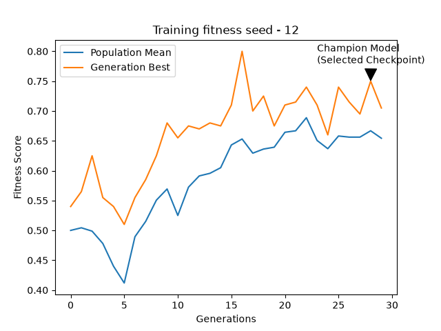

# Tic-Tac-Toe RL: Neuroevolution with PyTorch

I built a neural network that plays Tic-Tac-Toe and used a genetic algorithm to evolve its weights. Each candidate plays against a fixed, untrained opponent. Selection, crossover, and mutation produce the next generation, while an elite model keeps its weights unchanged.

I wanted to learn more about neural networks and PyTorch, and I had always wanted to train an AI for a game. Tic-Tac-Toe gave me a small enough problem to understand the whole process. I had also recently made my own Tic-Tac-Toe variant, so this was practice for eventually training an agent for that game.

This project started mostly out of curiosity. My aim was to understand what I was building and eventually have an agent I could play against.

## Results

This run used 8 candidates, 30 evaluated generations, and 100 games per candidate per generation. The graph shows measured fitness against that run's fixed training opponent. The two curves are the best score in each generation and the population mean.

I selected the checkpoint from **generation 28 of training seed 12**, even though generation 16 had the higher training fitness. When I evaluated the saved checkpoints against three new, untrained opponents, generation 28 scored **0.6650**, compared with **0.6008** for generation 16: a gap of about **0.0642**.

I then kept the selected checkpoint unchanged and evaluated it against a separate opponent pool.

| Evaluation | Opponent initialization seeds | Selected champion score | Untrained baseline score | Games per model |
| --- | --- | ---: | ---: | ---: |
| Validation: choose the checkpoint | 1000, 1001, 1002 | 0.6650 | 0.4567 | 600 |
| Final test: evaluate that choice | 2000, 2001, 2002 | 0.6750 | 0.4842 | 600 |

The final champion recorded **370 wins, 70 draws, and 160 losses**. Fitness gives half-credit for a draw: **(wins + 0.5 × draws) / total games**. Its final fitness score is 0.6750; its win rate is about 61.7%.

Each model plays 200 games against each opponent, balanced between starting positions. The baseline is an untrained neural network initialized with seed **9999**. Its random weights can still give it move preferences. Models keep their weights fixed during evaluation, while moves are sampled from their masked action distributions.

These results support the selected champion outperforming this baseline on the tested opponent pools. They do not establish optimal Tic-Tac-Toe play or a general advantage against every opponent.

Full results: [validation comparison](data/comparisons/comparison_2026-10-27_1.json) and [final-test comparison](data/comparisons/comparison_2026-10-27_2.json).

## How it works

### Board representation and network

I first recreated the game rules in Python. Each of the nine cells becomes three input features:

| Cell state | Encoding |
| --- | --- |
| Empty | `[1, 0, 0]` |
| Player 1 | `[0, 1, 0]` |
| Player 2 | `[0, 0, 1]` |

That gives **9 × 3 = 27 inputs**. One-hot encoding lets the first layer learn a separate contribution for each cell category, instead of tying the categories to scalar values 0, 1, and 2.

The network has the architecture **27 → 64 → 64 → 9**, with ReLU activations between the linear layers. Its nine output logits correspond to the nine possible board positions.

### Legal moves

The game produces a mask showing which squares are empty. Before choosing an action, the agent replaces the logits for occupied squares with **−1e9**. It then either samples from the masked distribution or selects the highest-scoring legal action in deterministic mode. The game loop stops when there is a win or draw.

### The genetic algorithm

1. Initialize a population and a fixed, untrained opponent using the run's seed.
2. Evaluate every candidate through complete games, alternating which agent starts.
3. Calculate fitness from wins and draws, then sort the candidates.
4. Preserve the configured number of elites unchanged and select a parent pool.
5. Create children through mutation, or uniform crossover followed by mutation.
6. Repeat until the final generation has been evaluated, recording results and saving checkpoints.

**Selection:** truncation takes the highest-scoring candidates. Tournament selection repeatedly samples a group and chooses its highest-scoring member for a parent slot. Sampling allows the same candidate to be selected more than once.

**Mutation:** an independent child copy receives zero-mean Gaussian noise on its weights and biases. `mutation_std` controls the noise scale. When annealing is enabled, that scale decreases over the reproduction steps.

**Crossover:** each weight or bias value is copied from one of two compatible parents. `inheritance` controls the probability of choosing parent B at each coordinate. Mutation is then applied to the resulting child.

The final training batch used population 8, parent count 2, elite count 1, tournament size 3, crossover inheritance probability 0.5, and mutation annealing from 0.1 to 0.02. Three runs completed, using seeds **10, 11, and 12**. I shortened the originally planned ten-run batch because of runtime; the next, interrupted run is not included as a completed run.

## Run the project

Run commands from the repository root. My development environment uses **Python 3.13.3**, **PyTorch 2.14.1**, and **Matplotlib 3.11.2**. The agent selects CUDA when available and otherwise uses CPU. The test suite has passed on CPU.

1. Clone the repository and open its root directory.
2. Create a virtual environment with `python -m venv .venv`.
3. Activate it with `.\.venv\Scripts\Activate.ps1` in Windows PowerShell, or `source .venv/bin/activate` on Linux/macOS.
4. Install the recorded dependencies with `python -m pip install -r requirements.txt`.

`requirements.txt` currently reflects my development environment and includes extra packages. A minimal dependency list and clean-install verification are still being worked on.

### Evaluate the supplied checkpoints

Run `python main.py`.

The current entry point loads the three checkpoint entries in [the committed index](data/checkpoints/leaderboard.json), compares them on the validation pool, and evaluates the selected model on the final pool. It writes new reports named `comparison_2026-10-27_1_test.json` and `comparison_2026-10-27_2_test.json` under `data/comparisons`. The original reports linked above preserve the recorded experiment results.

The reusable comparison helper accepts `leaderboard_dir`, so it can use the shipped `data/checkpoints` folder or a locally generated `Models` folder. Historical result JSONs retain their original `Models` paths; the index identifies the matching committed copies by filename.

### Tests and graph

- Run the tests with `python -m pytest tests -q`. The current suite has **37 tests**, covering game rules, evaluator accounting, masking, genetic operators, the mutation schedule, and checkpoint saving.
- Recreate the included training graph with `python graphing.py`. It reads the saved seed-12 history, saves a PNG under `data/graphs`, and displays it. It does not need another training run.

### Try a training run

Training configuration lives in the `train` helper in [main.py](main.py). Adjust its seeds, population, generation count, and game budget, then select that helper as the script's entry point instead of the two comparison calls. The current default entry point evaluates saved models.

Training writes raw histories to `runs` and checkpoints plus a leaderboard to `Models`. Those local output directories are ignored by Git. The existing ten-run configuration requests 240,000 training games, so start with a smaller budget while checking changes.

## Experiments and lessons learned

I explored three changes during development:

| Comparison | Variable changed |
| --- | --- |
| Truncation vs tournament | Parent selection method |
| Fixed mutation vs annealing | Mutation-noise schedule |
| Mutation only vs crossover followed by mutation | Crossover enabled or disabled |

These were small exploratory comparisons. Results varied with the seed and with whether I compared generation-best or population-mean fitness. I am still curating the historical run records before adding a detailed ablation-results table. The committed data currently contains the three final training histories and the validation/final-test evidence.

A useful debugging lesson came from the evaluator. When the champion changed argument position, I accidentally counted the other model's wins. That made the results misleading. Fixing the attribution and checking that wins + draws + losses matched the game count changed the interpretation of the experiment. I added regression coverage for that case.

I also learned why a high training score is not enough to choose a checkpoint, why saved model weights need stable identities, and how to turn stored experiment data into a graph with Matplotlib.

## Limitations and future work

- Training uses one fixed untrained opponent per run. A broader training-opponent pool could be a useful experiment.
- Validation and final testing each use three untrained neural opponents and one seeded baseline. This is a limited benchmark of playing strength.
- Crossover parent sampling permits the same model twice; distinct parents are not enforced.
- The scripts still use configuration inside Python files. A simpler command-line interface, import-safe entry points, and CPU CI are future setup improvements.

Next, I would like to try stronger opponents, behavioral diversity and immigration, REINFORCE fine-tuning, and a small human-versus-AI interface. Eventually I want to apply what I learned to my own Tic-Tac-Toe variant.

## AI assistance

I used ChatGPT, Gemini, and Grok for explanations, syntax help, reviews, tests, and utilities such as naming, saving, and formatting. I integrated and modified the project while learning how the pieces fit together. This README was edited with AI assistance using my original draft and the recorded project results.
